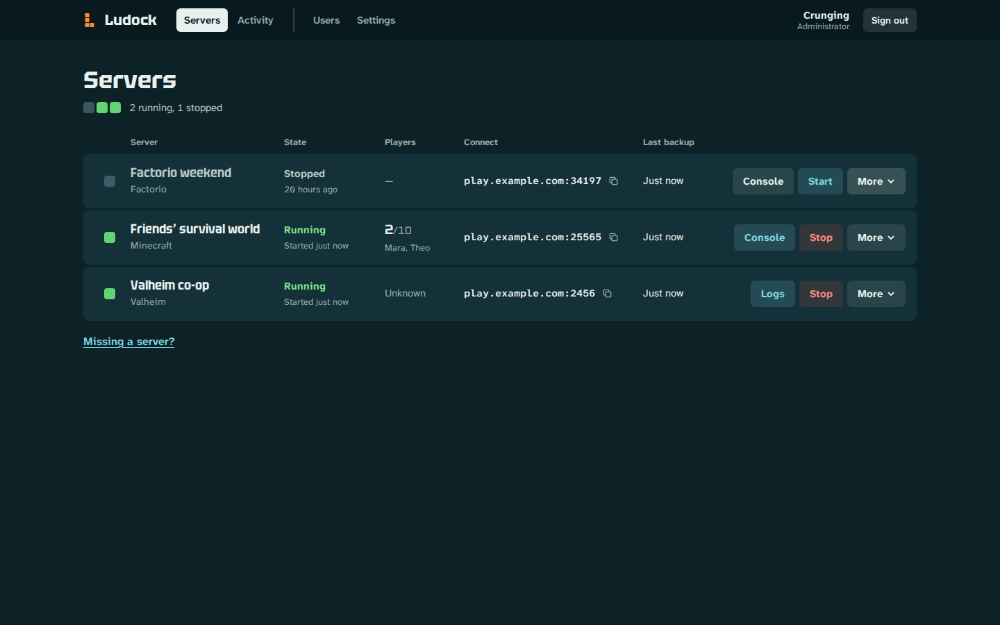
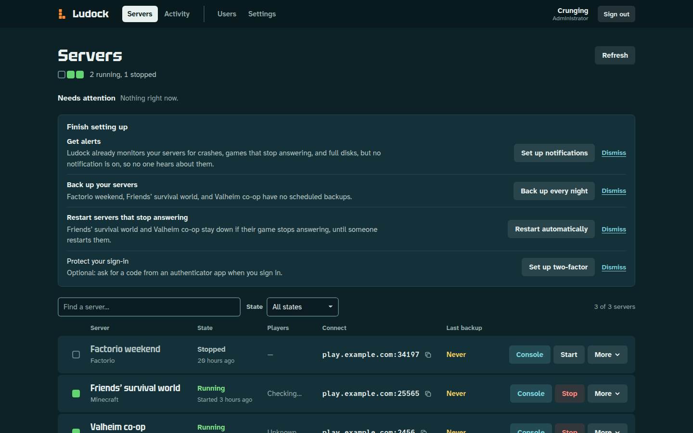
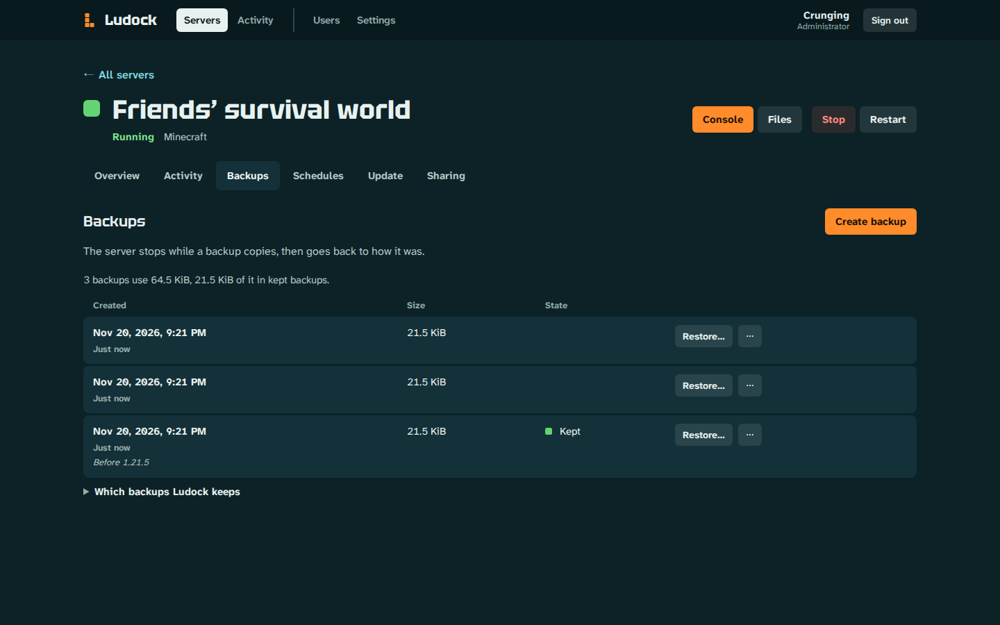
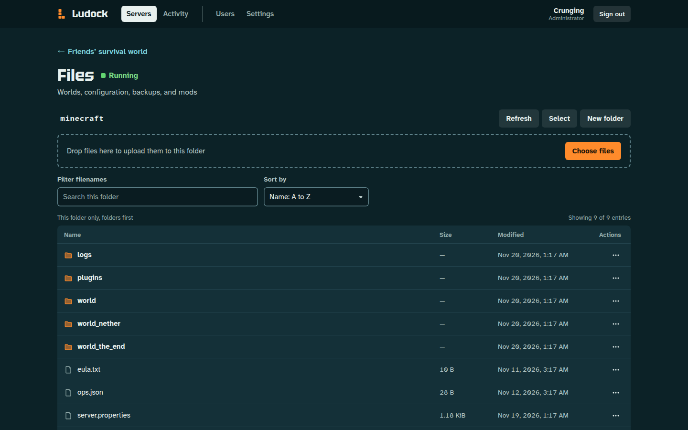
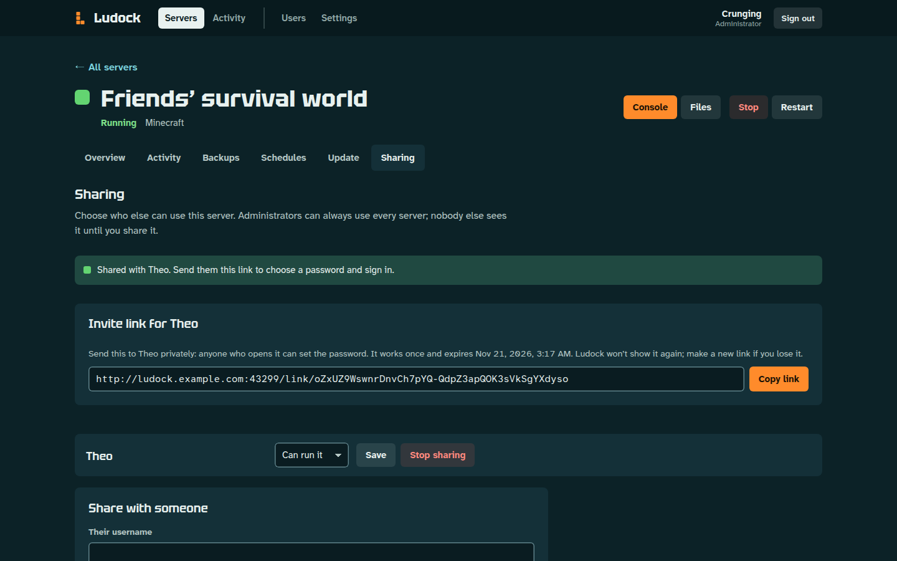

# Ludock

> **Beta:** expect bugs and changes. Keep your own backups of important game
> data, and [report issues](https://github.com/Crunging/Ludock/issues).

Ludock is a simple web panel for the Docker game servers you already run with
Compose, Portainer, or the Docker CLI. It finds them by itself and knows games:
who is online, saving before a stop, warning players before a restart, and
checking that the game itself still answers. Your servers stay yours: Ludock
never creates or edits them, and removing it leaves them as they were.



## Quick start

You need Docker Engine 25 or later with Compose, on Linux (AMD64 or ARM64).

1. On the host that runs your game servers, save
   [`compose.yaml`](./compose.yaml) and start Ludock:

   ```bash
   docker compose up -d
   ```

2. Get the setup code from its log. Until setup is done, restarting Ludock
   prints a new one.

   ```bash
   docker compose logs ludock
   ```

3. Open `http://<your-host>:3000`, enter the code, and create your account.

4. Follow the short **Finish setting up** list on the first page. It helps you
   set up alerts, and turns on nightly backups and automatic restarts in a click
   each.



Servers on [supported game images](./docs/REFERENCE.md#supported-games) appear
by themselves; several were [checked on real servers](./docs/REFERENCE.md#checked-on-real-servers). For any other container, choose **Missing a server?** under the
server list.

## What it does

- **Start, stop, and restart**, saving the world and warning players first on
  games that can.
- **Consoles and logs** in the browser, and a list of who is online, with kick,
  ban, and the Minecraft allowlist.
- **Files:** upload, edit, unpack, and download a server's data.
- **Backups** as plain tar archives, on a schedule, with weeks to months kept
  and an optional second copy on another disk. Restore a whole backup or one
  file.
- **Schedules** for starts, stops, restarts, backups, and console commands. By
  default, scheduled stops, restarts, and backups wait for players to leave and
  warn anyone still online with a countdown, where the game allows.
- **Alerts** to Discord, ntfy, Gotify, Telegram, email, or a webhook when a
  server goes down, its game stops answering, a backup fails, or a disk fills
  up, plus automatic restarts when a game hangs. If alerts stop getting through,
  Ludock says so.
- **Image updates**, with a backup first and the previous version put back if
  the new one fails to start. Ludock updates itself the same way, from
  **Settings**.
- **Sharing** a server with a friend by invite link, letting them see it, run
  it, or also change its files and make backups. Restoring and updates stay
  with administrators.

<details>
<summary>More screenshots</summary>

**Backups:** kept and recent backups of a server, ready to browse or restore.



**Files:** a server's data folders.



**Sharing:** an invite link for a friend.



</details>

## Security

Access to the Docker socket is control of the whole host, even mounted
read-only. Run Ludock on a trusted network, and use an HTTPS reverse proxy to
reach it from elsewhere. See [SECURITY.md](./SECURITY.md).

## Documentation

- [Guide](./docs/GUIDE.md): everyday tasks, and how backups, schedules,
  consoles, and monitoring behave.
- [Reference](./docs/REFERENCE.md): supported games, labels, limits, remote
  access, environment variables, and restoring Ludock itself.
- [Development](./docs/DEVELOPMENT.md): building, testing, and releasing.

Licensed under the [MIT License](./LICENSE).
